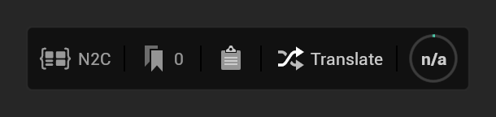

You translate a graph from the N2C bar that Node to Code puts at the bottom left of every graph in a Blueprint
editor, or from the Tag Manager in the Node to Code window for several graphs at once. This page covers the bar,
which graphs can be translated, and what happens when you click **Translate**.

## The N2C bar

From left to right:
- **N2C** opens the Node to Code window ([Opening the Editor](Opening-the-Editor)).
- The **tag** button shows how many tags the graph has; click it to add a tag (with a category) or remove one. Tagged
  graphs are listed in the Tag Manager.
- The **clipboard** button copies the graph as Node to Code JSON, the document a translation sends.
- **Translate** sends the graph to your provider. Set one up first ([Initial Configuration](Initial-Configuration)).
- The **ring** estimates the graph's size in tokens against the model's context window
  ([Handling Large Graphs](Handling-Large-Graphs)); **n/a** means there is nothing to translate yet.

## Which graphs can be translated

NodeToCode reads Blueprint graphs: event graphs, functions, macros, collapsed graphs and interface functions a
Blueprint implements, wherever they are nested. That includes the Blueprint graphs inside Widget, Editor Utility,
Level and Animation Blueprints: an Animation Blueprint's event graph, functions and transition rules. You can tag, copy
as JSON and translate any of them, from the graph overlay or from the NodeToCode window.

NodeToCode does not translate animation pose graphs (an Animation Blueprint's AnimGraph and the graphs inside its
states), state machines, Control Rig graphs, or any other graph that is not a Blueprint graph. On such a graph the
overlay's Copy JSON, Translate and tag buttons are grayed out, their tooltip says the graph type is not supported,
and the context ring reads **n/a**. Batch translation skips these graphs with the same reason. On other graphs the ring estimates what Translate sends (see
[Handling Large Graphs](Handling-Large-Graphs)).

Tags and translation records belong to one Blueprint's graph. A copy of a Blueprint made in the Content Browser starts
with no tags of its own, even though its graphs keep the original's internal IDs, and each open copy gets its own
overlay. Renaming or moving a tagged Blueprint in the editor takes its tags along.

If a tagged graph cannot be found any more (its Blueprint was deleted, or the graph was removed), translating,
exporting or double-clicking its row shows a notification naming the graph and its Blueprint. Remove the tag and tag
the graph again. The NodeToCode window's **Prune Missing** button removes the tags of every deleted Blueprint at once.

## Starting a translation

1. Focus the graph in its Blueprint editor and click **Translate** on its N2C bar. For several graphs, tag them, check
   them in the Tag Manager and click **Batch Translate** ([Window Overview](Top-Navbar-Overview)).
2. While the request runs, every N2C bar's **Translate** button reads **Translation in progress...** and only one
   translation runs at a time. If the Node to Code window is open, it comes to the front and shows the progress. If it is closed, a
   notification at the bottom right of the editor shows it instead, with **Cancel** to stop the request.
3. When the answer arrives, the translation is saved as files ([Utilizing Saved Translations](Utilizing-Saved-Translations)).
   An open window shows it in its viewer ([Viewing the Results](Viewing-the-Results)); otherwise the notification says
   the graph was translated and its **Open Result** button opens the window on the translation. If the request fails,
   the window's progress dialog or the notification says why.

## Behind the Scenes

When you trigger a translation, Node to Code [performs several steps](What-is-Node-to-Code#how-it-works).

> [!NOTE]
> Translation time can vary based on:
> - Graph complexity
> - LLM provider response time
> - Network conditions (for cloud-based LLMs)
> - Number of reference files included