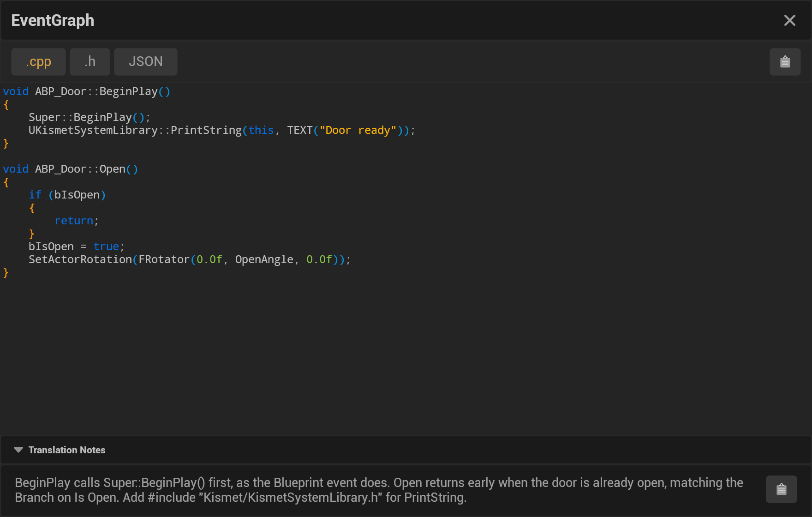

The code editor is the text area of the translation viewer: it shows the open file tab of a translation with syntax
highlighting, so you can review the generated code before you copy it into your project. Where it sits in the
window: [Window Overview](Top-Navbar-Overview#the-translation-viewer).

## Highlighting

The editor highlights code in the language the translation was written in: C++, Python, JavaScript, C#, Swift, or
pseudocode (Markdown). The **JSON** tab is highlighted as JSON. Colored are keywords, operators, strings, numbers,
comments, preprocessor directives and brackets; the colors and the rules are on
[Colors and Syntax Highlighting](Theme-&-Syntax-Highlighting).

## Reading and copying

- Scroll for longer files; the text uses a monospaced font at a fixed size.
- The text is read-only: you can select and copy it. To try a change, click **Edit** above the code (it reads
  **Editing** while on); the JSON tab stays read-only. Edits stay in the viewer, per graph and per tab, until another
  translation is loaded: the saved translation files are not changed
  ([Utilizing Saved Translations](Utilizing-Saved-Translations)).
- The clipboard button above the code copies the whole open tab, with your edits ([Copy & Integrate](Copy-&-Integrate)).

## The Code Editor widget in Editor Utility Widgets

The **Code Editor** UMG widget that 1.x Editor Utility Widgets embed still loads, but it is unsupported and will be
removed. Its **On Text Changed**, **On Cursor Moved** and **On Selection Changed** events fire when you type, move
the cursor or change the selection (selection events give the first and last line). Text you type is kept when the
widget's properties are synchronized.
