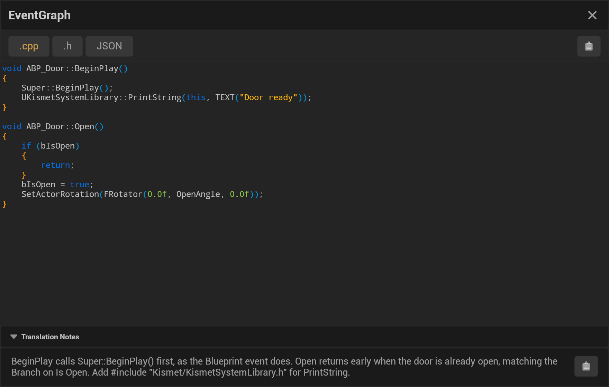

Every translation comes with notes from the model: what the generated code needs to compile, what it assumes, and
which Blueprint nodes it left out because they never run. They appear in the **Translation Notes** panel under the
code, and are saved next to the code files as `<GraphName>_Notes.txt`.

## The panel

- **Translation Notes** sits at the bottom of the translation viewer. Click its header to fold or unfold it.
- The clipboard button at its right copies the notes.
- A translation without notes says **No implementation notes available.**

## What the notes cover

What the model writes depends on the language and the graph. Typical notes:

- **Setup:** headers to include and modules to add to your `Build.cs` (C++), imports or packages (other languages).
- **Assumptions:** members, components or functions the code expects your class to have, and placeholders for engine
  calls a language cannot make.
- **Nodes left out:** each node the Blueprint never runs (unused, unreachable or disabled), by its id and name.
- **Behaviour:** where the code differs from the Blueprint, for example how a latent node or a timeline was rebuilt.

Read them before you copy the code into your project ([Copy & Integrate](Copy-&-Integrate)), and check the
[review steps](Viewing-the-Results#reviewing-the-translation).
