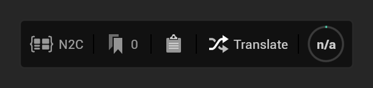
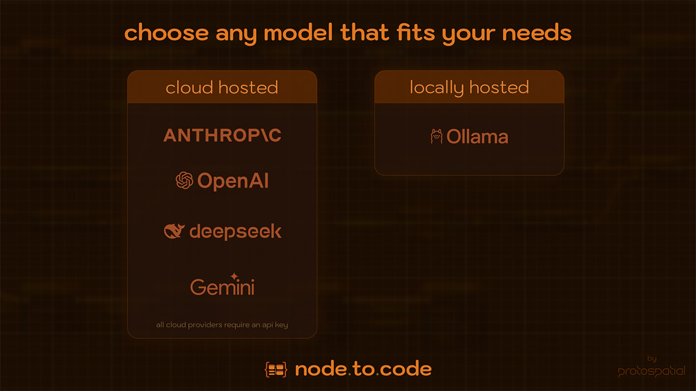
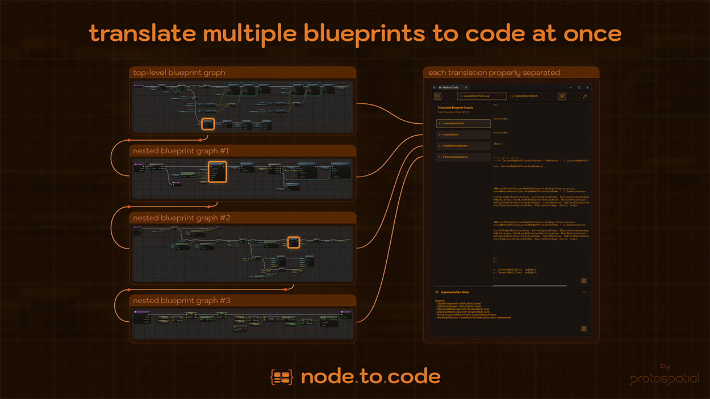

Node to Code translates Blueprint graphs into C++, Python, JavaScript, C#, Swift or pseudocode with the LLM provider
you choose, keeps every translation as files, and serves your open Blueprints to AI agents over MCP. The sections
below summarize each feature and link to its page.

## [Translate from any graph](Accessing-and-Triggering-Translation)

Every Blueprint graph shows the N2C bar at its bottom left:

**Translate** sends the graph; **N2C** opens the Node to Code window; the tag button tags the graph for later; the
clipboard button copies the graph as Node to Code JSON; the ring shows the graph's size in tokens. The capture
records the whole graph: execution order, data wires and pin types, node comments, variables and their defaults, and
the functions, macros and collapsed graphs it uses.

## [Your choice of LLM provider](Choosing-an-LLM-Provider)

- **Cloud:** Anthropic, OpenAI, Google Gemini and DeepSeek, each with your own API key, stored in Windows Credential
  Manager ([Initial Configuration](Initial-Configuration)).
- **Local:** Ollama and LM Studio run the model on your machine: no key, no cost per request, nothing leaves the
  machine.

What each provider receives and keeps: [Data Flow and Privacy](Data-Flow-and-Privacy). Models and settings:
[Provider Configuration](Provider-Configuration).

    

## [Nested graphs](Translation-Depth)

With **Max Translation Depth** above 0 (up to 5), a translation also includes the graphs the selected graph calls:
your functions, macros and collapsed graphs, each translated in the same request.

    

## [Tags and batch translation](Viewing-the-Results#tags-and-the-graph-list)

Tag graphs into categories from their N2C bar, then pick them in the Tag Manager, see their token counts and the
estimated cost, and translate or export them in one batch ([Window Overview](Top-Navbar-Overview)).

## [The translation viewer](Viewing-the-Results)

Each translation opens with its files in tabs (implementation, a C++ header, and the JSON it was made from), syntax
highlighting ([Code Editor](Code-Editor)), the model's [Translation Notes](Implementation-Notes) and copy buttons.
Colors are settings ([Colors and Syntax Highlighting](Theme-&-Syntax-Highlighting)).

## [Reference Source Files](Reference-Source-Files)

Add your own .h and .cpp files in the settings so translations follow your code's classes, names and style.

## [Saved translations](Utilizing-Saved-Translations)

Every translation is saved under your project's `Saved/NodeToCode/Translations` (or a folder you choose): the code
files, the notes, the Blueprint JSON that was sent and the provider's answer.

## [AI agents over MCP](developers/Connecting-an-MCP-Client)

While the editor is open, an MCP server on your machine lets agents such as Claude Code, Cursor or Codex read your
Blueprints, edit graphs and start translations, with [Agent Skills](developers/Agent-Skills) that teach them the
workflow ([Security Model](Security-Model)).
