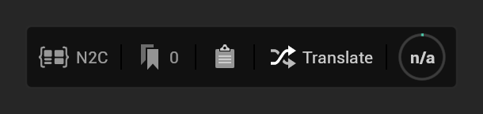

The Node to Code window is a dockable editor tab that holds the Tag Manager and the translation viewer. You open it
from the N2C bar that every Blueprint graph shows at its bottom left; there is no toolbar button or menu entry.

## Opening it

- Click **N2C** on the bar at the bottom left of any graph in a Blueprint editor. If the window is already open
  somewhere, it comes to the front.
- A translation started from the bar or from the Tag Manager shows its progress and its result in the window.

What the window contains: [Window Overview](Top-Navbar-Overview).

## Docking

The window behaves like any Unreal Editor tab: dock it next to other tabs, inside the Blueprint editor, or let it
float as its own window. The editor's layout remembers where you put it. There is one Node to Code window at a time.
