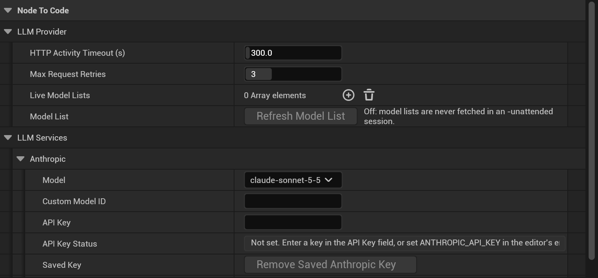

### Plugin Settings → Provider Configuration
***

## Provider Selection & Setup

Choose your [preferred LLM provider](Choosing-an-LLM-Provider) with **Provider** in **Editor Preferences → Plugins → Node to Code (User)** (or the
provider picker in the Node to Code window, or the Get Started card). The provider is yours only: it is saved in your
user settings, not in the project. Each provider's model and options below are in the
[Plugin Settings](Initial-Configuration#accessing-plugin-settings) (Project Settings), shared by the project.
Each cloud provider's **Model** is a model ID picked from the list of models Node to Code knows (shown below by
name, with the ID the list shows). A deprecated model says so in the list, with its shutdown date. **Custom Model
ID**, when set, is sent instead: use it for a model released after your Node to Code version. Node to Code then has no
context size or price for it, so its cost shows as unknown; add one under
[Model Price Overrides](#model-price-overrides) to see costs. To pick from the models your key can actually use, turn
on [Live Model Lists](#live-model-lists).

### [Anthropic](LLM-Provider-Documentation-&-Resources#anthropic-claude)
- **API Key**: Enter your Claude API key and press Enter; it is saved to Windows Credential Manager and the field empties. **API Key Status** shows where the key in use comes from
- **Model**:
  - **Claude Sonnet 5.5**, `claude-sonnet-5-5` (default, recommended)
  - **Claude Opus 5.5**, `claude-opus-5-5` (most capable)
  - **Claude Haiku 5.5**, `claude-haiku-5-5` (lowest cost)
  - **Claude Opus 4.5**, `claude-opus-4-5-20251101`
  - **Claude Sonnet 4.5**, `claude-sonnet-4-5-20250929` (retires 2026-11-30)
- **Max Output Tokens**: 0 (Auto) by default, see [Output Token Budget](#output-token-budget)

### [OpenAI](LLM-Provider-Documentation-&-Resources#openai)
- **API Key**: Enter your OpenAI API key and press Enter; it is saved to Windows Credential Manager and the field empties. **API Key Status** shows where the key in use comes from
- **Model**:
  - **GPT-6.1 Sol**, `gpt-6.1-sol` (default, recommended)
  - **GPT-6 Astra**, `gpt-6-astra` (most capable)
  - **GPT-6 Luna**, `gpt-6-luna` (lowest cost)
  - `gpt-5.2`, `gpt-5.2-pro`
  - `gpt-5`, `gpt-5-mini`, `gpt-5-nano` and `o3` (shut down 2026-12-11)
  - `gpt-4.1`, `gpt-4o-2024-08-06` and `gpt-4o-mini-2024-07-18` (shut down 2027-01-14)
- **Max Output Tokens**: 0 (Auto) by default, see [Output Token Budget](#output-token-budget)

### [Google's Gemini](LLM-Provider-Documentation-&-Resources#gemini)
- **API Key**: Enter your Gemini API key and press Enter; it is saved to Windows Credential Manager and the field empties. **API Key Status** shows where the key in use comes from
- **Model**:
  - **Gemini 3.8 Flash**, `gemini-3.8-flash` (default, recommended)
  - **Gemini 4 Argon**, `gemini-4-argon` (most capable)
  - **Gemini 3.5 Flash-Lite**, `gemini-3.5-flash-lite` (lowest cost)
  - **Gemini 3 Flash Preview**, `gemini-3-flash-preview`
- **Max Output Tokens**: 0 (Auto) by default, see [Output Token Budget](#output-token-budget)

A model with a date still works until that date, then the provider turns it off. Switch to one of the
recommended models before then.

### Retired models

Models the provider has shut down are no longer offered in the **Model** list. If your project had one selected
(for example Claude 3.7 Sonnet, o4-mini or Gemini 2.5 Flash Preview), Node to Code selects that provider's default
model when the editor starts, saves it to the project's config and writes one warning to the Output Log. A
**Custom Model ID** is never changed.

### Live Model Lists

Off by default. **Live Model Lists** (Project Settings → Node to Code → LLM Provider) names the providers whose model
list Node to Code asks the provider for: `anthropic`, `openai`, `gemini`, `deepseek`, `ollama`, `lmstudio`, an
OpenAI-Compatible preset (`vllm`, `openrouter`, `groq`, ...) or one of your own profile IDs. For a listed provider
that is your active **Provider** and has a key, the list is fetched when the editor starts, when you enter a new key,
when you add the provider, and when you press **Refresh Model List** in the **Model List** row (the row also says how
many models the last list had and when it was fetched). Nothing is fetched in commandlets or unattended runs (build
machines, automated tests).

With a list:

- The **Model** list adds the models your key can use that Node to Code does not know, marked *live list, price
  unknown*. Their context size comes from the provider; their cost shows as unknown (never $0) until you add a
  [price override](#model-price-overrides).
- A known model the list lacks is marked *not in your key's model list*; one the provider deprecates is marked with
  its shutdown date.
- If your selected model is missing from the list or deprecated, a notification and an Output Log warning say so.
- Each list is saved under `Saved/NodeToCode/ModelCache/<provider>.json` in your project, so an offline start shows the
  last list. If a fetch fails, the last list and the built-in list stay in use.

The list never holds or sends anything but the model IDs and their limits; the key is sent in a request header only.

### [DeepSeek](LLM-Provider-Documentation-&-Resources#deepseek)
- **API Key**: Enter your DeepSeek API key and press Enter; it is saved to Windows Credential Manager and the field empties. **API Key Status** shows where the key in use comes from
- **Model**: `deepseek-flash` (default, recommended) or `deepseek-v4-pro` (most capable)
- **Thinking**: `high` (default) thinks at high effort; `none` turns thinking off and asks for JSON output, faster
  and cheaper; `low` and `max` are the other efforts DeepSeek offers
- **Max Output Tokens**: 0 (Auto) by default, see [Output Token Budget](#output-token-budget)

DeepSeek discontinued `deepseek-reasoner` and `deepseek-chat` on 2026-07-24. A project that saved DeepSeek R1 or
DeepSeek V3 keeps working without changes: R1 becomes `deepseek-flash` with Thinking `high`, and V3 `deepseek-flash`
with Thinking `none`. A model chosen per request through the MCP `translate-focused-blueprint` tool uses that model's
own thinking mode (for `deepseek-flash` that is thinking on, unless it is also the model selected here).

### [Ollama (Local Processing)](LLM-Provider-Documentation-&-Resources#ollama-local)
- **Endpoint**: Default http://localhost:11434/
- **No API Key Required**
- **Advanced Settings**:
  - Model name (e.g., codellama:code)
  - Use System Prompts (on by default; turn it off only for a model whose template drops system messages)
  - Think: **Model Default** sends nothing, **On** and **Off** switch thinking on or off, and **Level** sends a
    level name for models that take one (for example `low`, `medium` or `high` for gpt-oss; `ollama show <model>`
    lists them). This replaces typing `/no_think` into Prepended Model Command.
  - Context Window (0 = the server's context length). The system prompt alone is about 4-5K tokens, so 32K-64K is
    recommended (see [Translation Depth](Translation-Depth) for guidance). Ollama cuts a prompt that is longer than
    the window without an error; NodeToCode logs a warning when its estimate of the prompt does not fit.
  - Max Tokens (0 = no limit, the server default)
  - Keep Alive Duration (seconds; 0 unloads the model after each request, -1 keeps it loaded)
  - Temperature, Top P, Top K, Min P, Repeat Penalty, Mirostat Mode, Mirostat Eta, Mirostat Tau and Random Seed:
    each is sent only when its checkbox is ticked. Unticked, the model's own defaults apply, which are usually
    tuned for that model.

Settings saved by an earlier version are updated once when the editor loads them: values equal to the old built-in
defaults (Context Window 8192, Max Tokens 8192, Temperature 0, Top P 0.5, Top K 40, Min P 0.05, Repeat Penalty 1.1,
Use System Prompts off) are cleared so the server and model defaults apply, and any other value you had set is kept
with its checkbox ticked.

### [LM Studio (Local Processing)](LM-Studio-Quick-Start)
- **LM Studio Server Endpoint** (default http://localhost:1234; yours only, in **Editor Preferences → Plugins → Node to Code (User)**) and **Model Name** (the model loaded in LM Studio, default `qwen3-32b`); no API key
- **Prepended Model Command**: optional text added to the start of each message, for example `/no_think` to turn off
  thinking on reasoning models. Sampling settings are set in the LM Studio app. Setup: [LM Studio Quick Start](LM-Studio-Quick-Start)
- **Max Output Tokens**: 0 (Auto) by default, which sends no `max_tokens`, so the server uses whatever context the
  prompt leaves. See [Output Token Budget](#output-token-budget)

### OpenAI-Compatible (vLLM, llama.cpp, OpenRouter, Groq, Azure and more)
Pick **OpenAI-Compatible** as the **Provider**, then set these in **Editor Preferences → Plugins → Node to Code
(User) → OpenAI-Compatible** (yours only, not shared with the project):
- **Provider Profile**: the server. Presets: `vllm` (http://localhost:8000/v1), `llamacpp` (llama.cpp's server,
  http://localhost:8080/v1), `ollama-openai` (Ollama's /v1 endpoint), `openrouter`, `groq`, `together`, `fireworks`,
  `xai`, `mistral`, `azure-openai`, `bedrock`, `gemini-openai`, `minimax`, `kimi` and `zai`. Each preset already knows
  how its server takes the output format, the token budget, thinking and the key.
- **Model**: the model ID the server serves, as its `/v1/models` list names it (for vLLM, the `--served-model-name`).
- **Base URL Override**: a different address for the preset, up to and including the version: a vLLM on another
  machine (`http://gpu-box:8000/v1`), your Azure resource (`https://my-resource.openai.azure.com/openai/v1`) or
  another Bedrock region. Empty keeps the preset's address.
- **Custom Provider Profiles**: a server the presets do not cover. Give it an **Id** (then pick that Id as the
  **Provider Profile**), its **Base Url**, the **Auth Style** (`bearer`, `api-key`, `x-api-key` or `none`), the
  **Api Key Environment Variable** that holds its key, the **Structured Output** mode it supports and any extra headers.

Keys for the hosted presets come from environment variables set before the editor starts (no key is saved in these
settings): `OPENROUTER_API_KEY`, `GROQ_API_KEY`, `TOGETHER_API_KEY`, `FIREWORKS_API_KEY`, `XAI_API_KEY`,
`MISTRAL_API_KEY`, `AZURE_OPENAI_API_KEY`, `AWS_BEARER_TOKEN_BEDROCK`, `MINIMAX_API_KEY`, `MOONSHOT_API_KEY`,
`ZAI_API_KEY`; `gemini-openai` uses your Gemini key. Local servers (`vllm`, `llamacpp`) send a key only when
`VLLM_API_KEY` or `LLAMA_API_KEY` is set. OpenAI-Compatible requests send no output budget, so the server uses the
context the prompt leaves. DeepSeek and LM Studio work the same way inside: they are presets of the same
OpenAI-compatible adapter, with their own settings above.

## Output Token Budget

Each provider except Ollama has a **Max Output Tokens** setting: the most tokens one translation may write. On
reasoning models the thinking tokens count against it too.

- **0 (Auto, the default)**: for Anthropic, OpenAI, Gemini and DeepSeek, NodeToCode sends the model's maximum output,
  but at most 32,000 tokens (65,536 for DeepSeek thinking modes, whose reasoning counts against the limit), and less
  when needed so the prompt plus the output fits the model's context window. The ceiling is there because requests
  are not streamed yet, and a very long request without streaming can time out; it goes away once NodeToCode
  streams responses. Anthropic always gets a value
  because its API requires one; for a model name NodeToCode does not list (such as a newer ID passed by an MCP
  client) the other providers get none, so the provider's own default applies. For LM Studio, Auto sends no limit
  at all, so the server uses the context left after the prompt. A local server with a small window, such as vLLM
  started with `max_model_len 16384`, needs this: any fixed limit plus the prompt can be larger than the window,
  and the server then rejects the request.
- **Any other value** is sent as-is, capped at the model's maximum output when NodeToCode lists the model (not at
  the Auto ceiling: set a larger value yourself if a translation needs it and your requests finish in time). OpenAI
  reasoning models receive it as `max_completion_tokens`, other OpenAI models as `max_tokens`, and models on the
  Responses API as `max_output_tokens`. Set a value to limit the cost of a single translation; if translations end
  in a truncated or malformed JSON error, raise it or set it back to 0.

Before 2.0 every request asked for 16,000 output tokens and there was no setting. Projects saved by an earlier
version load with Max Output Tokens 0 (Auto). Ollama keeps its own **Max Tokens** setting in the Advanced Settings
above.

## Reported Token Usage

Each saved translation and `BatchSummary.json` record the tokens the provider reported, counted the same way for
every provider: input includes cached input (Anthropic reports its cache reads and writes apart from `input_tokens`;
NodeToCode adds them), and output includes thinking (Gemini reports `thoughtsTokenCount` apart from the answer;
NodeToCode adds it). The cached and thinking parts are also recorded on their own where the provider reports them:
cache reads (Anthropic, OpenAI, Gemini, DeepSeek, LM Studio), cache writes (Anthropic) and thinking (OpenAI, Gemini,
DeepSeek, LM Studio). Ollama reports input and output only. See
[Utilizing Saved Translations](Utilizing-Saved-Translations) for the field names.

## Request Timeout

**LLM Provider → HTTP Activity Timeout (s)** (default 300) is how long a translation request may wait without
receiving anything from the provider. When it passes, the translation fails with a `Timeout` error instead of
waiting: a provider that accepts the request and then stalls no longer holds a translation or a batch for up to an
hour. Responses are not streamed yet, so the provider sends nothing until the whole answer is ready: raise this for
very long translations (a large Max Output Tokens, a reasoning model) or a slow local model. The whole request is
also limited to 3600 seconds.

## Request Retries

**LLM Provider → Max Request Retries** (default 3, 0 to 10) is how many times NodeToCode sends a request again when
the provider answers 429 (rate limited), 529 (overloaded) or another 5xx server error. It waits as long as the
provider asks (`Retry-After`), or else 1 second, then 2, then 4 (each with a little random extra), never more than 60
seconds; a provider that asks for a longer wait gets no retry and the translation fails at once. A 429 that says the
account is out of credit or quota (OpenAI's "You exceeded your current quota" or "no credits remaining", Gemini's
spent daily quota or depleted prepayment credits, DeepSeek's "Insufficient Balance") is not retried either: it fails
at once as a `Billing` error, since waiting cannot fix it. Other errors (a bad key, a bad request) are not retried. The Output Log shows each retry ("HTTP 429 from ...: retrying in 2.0 s"). 0
turns retries off.

Settings are read again for every request: a provider, model, API key or timeout you change applies to the next
translation, including the next graph of a batch that is already running.

## Model Price Overrides

Cost estimates use each model's list price. To use your own (a discount, or a **Custom Model ID**), add an entry
under **LLM Services → Pricing → Model Price Overrides**: the key is the model ID, the value the input and output
price in USD per million tokens. Ollama and LM Studio are always free. A cloud model Node to Code has no price for (a
**Custom Model ID**, or a model from a [live model list](#live-model-lists)) shows its cost as unknown until you add one.

An estimate counts what each request sends: the graph's N2C JSON plus the system prompt for the target language and
your reference files (a batch sends those once per graph). The reply is priced at the output price, as about the
graph's size and at most the model's output limit. The batch panel shows the total with its input and output parts,
and follows a price, model or provider change at once. The context bar compares the graph plus that prompt with the
model's usable context window.

## Subscription sign-in removed in 2.0

Every cloud provider (Anthropic, OpenAI, Gemini, DeepSeek) needs its **API Key**; Ollama and LM Studio need
none. Sign-in with a Claude Pro/Max subscription or a Google account was removed; a project that had it selected
now uses the API key. To use a Claude, ChatGPT or Google AI subscription, connect Claude Code, Antigravity CLI or
Codex CLI to the NodeToCode MCP server: see [Using a Claude or Gemini Subscription](Using-a-Claude-or-Gemini-Subscription),
which also covers the old setting and saved tokens.

## Sampling Settings for Cloud Models

For cloud providers, NodeToCode sends a temperature only to models that accept one, and otherwise leaves the provider's default in place. Current Claude models (Opus 4.7 and later), OpenAI reasoning models (the o-series and GPT-5 family) and Gemini 3 models get no temperature, top P or top K, because they reject those settings or work worse with them. A model name NodeToCode does not list, such as a newer ID passed by an MCP client, is treated the same way. Ollama uses the **Advanced Settings** above, and LM Studio uses the sampling settings in the LM Studio app.

## Best Practices

1. **API Key Security**
   - Never commit API keys to version control. Node to Code keeps them outside the project, in Windows Credential
     Manager on Windows (see [where API keys are stored](Initial-Configuration#where-api-keys-are-stored), which also
     says how to remove them)
   - The **API Key** fields are masked and write-only: a key you enter is saved and the field empties, and **API Key
     Status** shows where the key in use comes from
   - Regularly rotate keys for security
   - Each request carries the key in one header only (Anthropic `x-api-key`, Gemini `x-goog-api-key`, OpenAI,
     DeepSeek and LM Studio `Authorization`), never in the URL, and the key is kept out of the
     [log](Logging-Configuration#what-the-log-never-holds) and error messages
   - The key is looked up (the saved key, else the environment variable) when each request is sent and is not kept
     in the request configuration, so Blueprint or Python code reading the LLM module's configuration or the settings
     sees no key
   - Configure through [Plugin Settings](Initial-Configuration#accessing-plugin-settings), or for build machines
     and CI through [environment variables](Initial-Configuration#api-keys-from-environment-variables)

2. **Model Selection**
   - Start with recommended models for your use case
   - Consider [cost vs capability](Choosing-an-LLM-Provider) tradeoffs
   - Monitor token usage and adjust as needed

3. **Local Processing**
   - Ensure sufficient system resources for Ollama or LM Studio
   - Monitor GPU/CPU usage
   - Adjust context window based on translation needs

## More Provider Resources

- Not sure which model fits your needs? See [Choosing an LLM Provider](Choosing-an-LLM-Provider).
- Provider documentation and references: [LLM Provider Documentation & Resources](LLM-Provider-Documentation-&-Resources).
