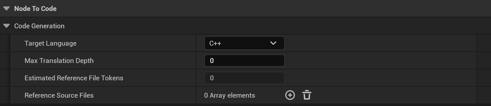
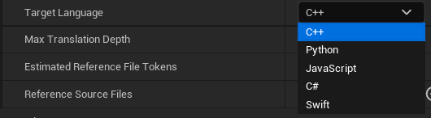

### Plugin Settings → Target Language
***

## Target Language

Choose the output programming language:

- C++ (Default, for Unreal Engine integration)
- C# (Tries to steer towards Unity C#)
- Python (For external tool development)
- JavaScript (Web-based tools or external systems)
- Swift (VisionOS or iOS)
- Pseudocode (Great for communicating language-agnostic code!)

A material graph is explained, not translated: its translation uses Pseudocode only, with a prompt of its own
that reads the material from its outputs back. Asking for a material in any other language fails at once with
`TARGET_NOT_AVAILABLE_FOR_MATERIALS`, before anything is sent to the LLM.

**Target Language** is in **Project Settings → Plugins → Node to Code → Code Generation**, beside
[Max Translation Depth](Max-Translation-Depth) and [Reference Source Files](Reference-Source-Files):

    

        
    

## Verify and Refine

**Verify and Refine** (same section) lists the target languages whose translations Node to Code checks when they
arrive. It is empty, so off, by default. For a listed language:

- Python translations are parsed with the editor's own Python; a syntax error is an error.
- In every language, each function call, variable and event the graph runs must appear in the code; a missing one is
  a warning.
- C++ is compiled in a scratch module when the console variable `n2c.Verify.CppCompile` is 1 (off by default; it
  blocks the editor while UnrealBuildTool runs). Each compiler error is an error.

When the code has errors, the translation is sent back to the model with the findings and the model is asked for a
corrected answer, up to **Max Refine Turns** times (default 2, 0 to 5; 0 checks without resending). Each refine turn
is one more request, billed like the first. While it runs, the progress dialog or notification says
**refine turn 1**, **2**, ...; **Cancel** stops it. The result keeps the last answer, and the translation viewer shows
how it ended: **Verified: passed** (or **passed after N refine turns**), **N errors left after N refine turns**, or
**skipped** when no check could run. Warnings never cause a refine turn; they are counted in the status and listed in
its tooltip. Every attempt's findings are saved as `Verify.json` beside the translation's files
([Utilizing Saved Translations](Utilizing-Saved-Translations)). Batch Translate checks each graph the same way.

> [!NOTE]
> Due to the nature of UE Blueprints, using other target
> languages outside of the default C++ can have more varying degrees
> of successful compilation and should be used more as learning
> or communication vessels rather than ground-truth code.