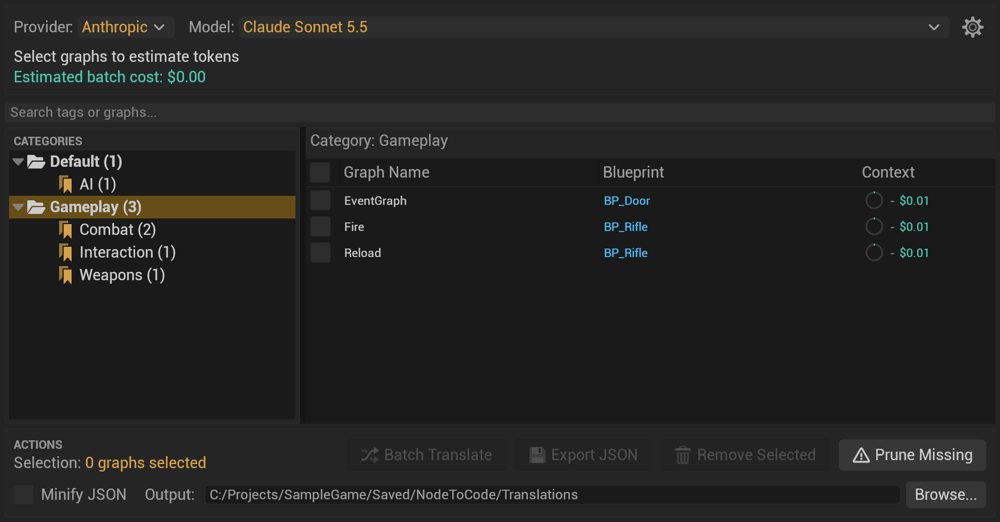
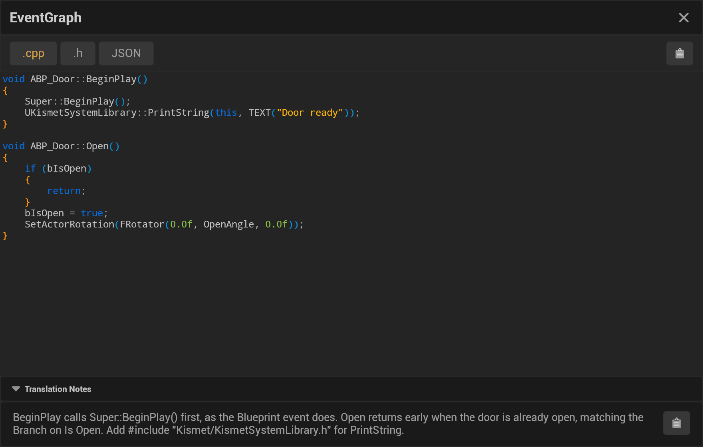

The Node to Code window has two parts: the **Tag Manager**, where you pick tagged graphs and translate them, and the
**translation viewer**, which shows a translation's files and notes. This page names every control in both. To open
the window, click **N2C** on the bar at the bottom left of any Blueprint graph ([Opening the Editor](Opening-the-Editor)).

## The Tag Manager

From top to bottom:

1. **Provider and Model.** The provider and model the next translation uses, the same settings as in Project
   Settings ([Provider Configuration](Provider-Configuration)). The gear button opens the Node to Code settings.
   Below them, the token count of the checked graphs and the **Estimated batch cost** (**Free (local model)** for
   Ollama and LM Studio).
2. **Search tags or graphs.** Lists the graphs whose name, Blueprint, tag or category matches what you type.
3. **Categories.** Tag categories and their tags, each with the number of graphs it holds. Select one to list its
   graphs. A first tag comes from the tag button on a graph's N2C bar.
4. **The graph list.** One row per graph, with columns you can sort by clicking their header:
   - the checkbox (the header's checkbox checks every row shown);
   - **Graph Name** (hover it to see the graph's tags);
   - **Blueprint**, with the row's buttons at its right end when you hover: **Translate this graph**, **View
     translation** (greyed out until there is one) and **Export as JSON**;
   - **Context**: the graph's size in tokens as a ring and its estimated cost (click the ring to refresh it).

   Double-click a row to open its translation. Right-click a row for **Translate**, **View Translation**, **Export
   JSON**, **Open in Blueprint** and **Remove Tag**. Click, Shift-click and Ctrl-click check rows like a selection.
5. **Actions.** **Selection** counts the checked graphs. **Batch Translate** sends one request per checked graph
   (its progress dialog lists each graph with its Blueprint, for example `N2CFn (BP_A)`, with that graph's own status;
   **Cancel** or Escape stops the request in flight, the dialog reads **Cancelling...** until it has stopped, and the
   graphs not translated by then are marked skipped. If the batch cannot start, a notification says why),
   **Export JSON** saves their Node to Code JSON to a new `BatchJson_...` folder in the **Output** folder (**Minify
   JSON** writes it on one line) and then says how many graphs it wrote, with an **Open folder** link, and
   **Remove Selected** takes the listed tags off them. These three are greyed out until you check a graph.
   **Tag Dependencies** applies the tag selected in the tree to every graph of every Blueprint, interface and macro
   library the checked graphs' Blueprints depend on (calls, casts, variables, parents, interfaces, macros, through
   each other), so you can translate a Blueprint's dependencies first; structs and enums have no graph and are named
   in its notification. **Reference Viewer** opens Unreal's Reference Viewer on the checked graphs' Blueprints.
   **Prune Missing** removes the tags and translation records of graphs whose Blueprint was deleted (the files on
   disk are kept). **Output** and **Browse...** set the folder translations and exports are saved in;
   **Browse...** saves it as your own **Custom Translation Output Directory** (Editor Preferences → Plugins → Node to
   Code (User)) ([Utilizing Saved Translations](Utilizing-Saved-Translations)).

Removing tags asks first and then offers **Undo** for ten seconds. More on tags: [Viewing the Results](Viewing-the-Results#tags-and-the-graph-list).

## The translation viewer

1. **Title and close.** The name of the graph whose translation is open; the cross closes the viewer and returns to
   the Tag Manager.
2. **File tabs.** The implementation, labelled with its extension (**.cpp**, **.py**, **.js**, **.cs**, **.swift**,
   or **.md** for pseudocode); the declaration (**.h**), present only for C++; and **JSON**, the Node to Code JSON
   the translation was made from. The viewer opens on the implementation.
3. **Copy.** The clipboard button at the right copies the open tab's text.
4. **The code**, highlighted in the translation's language ([Code Editor](Code-Editor)).
5. **Translation Notes.** What the model says the code needs and assumes (includes, members, nodes it left out
   because they never run). Click the header to fold the panel; its own button copies the notes
   ([Implementation Notes](Implementation-Notes)).

The window has no theme or font controls. Its colors are settings: [Colors and Syntax Highlighting](Theme-&-Syntax-Highlighting).
