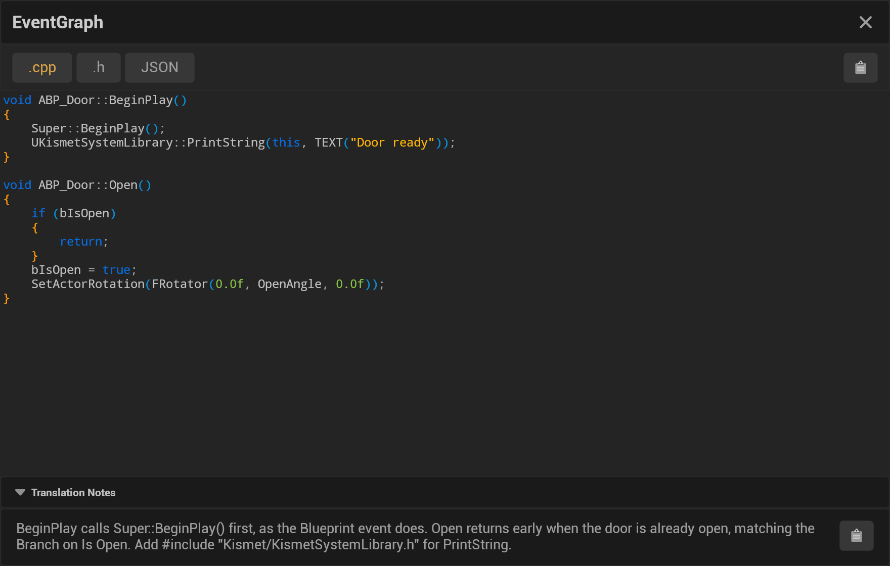

When a translation finishes, the Node to Code window opens it in the translation viewer. This page says what the
viewer shows, how to get back to earlier translations, and how the Tag Manager's list works. Every control is named
in [Window Overview](Top-Navbar-Overview).

## The translation viewer

- **The file tabs**: the implementation, labelled with the translation's extension (**.cpp**, **.py**, **.js**,
  **.cs**, **.swift**, or **.md** for pseudocode); **.h**, only when the translation has a declaration, which in
  practice means C++; and **JSON**, the Blueprint graph the translation was made from. The viewer opens on the
  implementation and highlights it in the translation's language. A translation opened from the graph list is that
  row's Blueprint's own (a copy of a Blueprint keeps separate translations) and uses the language it was saved in.
- **The code** ([Code Editor](Code-Editor)). The clipboard button at the top right copies the open tab.
- **Translation Notes**: the model's notes on what the code needs and assumes ([Implementation Notes](Implementation-Notes)),
  with their own copy button.
- The cross at the top right closes the viewer and shows the Tag Manager again.

Every translation is also saved as files ([Utilizing Saved Translations](Utilizing-Saved-Translations)). To open an
earlier one, select its graph in the Tag Manager and double-click the row, or use **View Translation** in its
right-click menu or its hover buttons.

## Your first visit

Until the project has a saved translation, a **Get started** card sits at the top of the window. It walks through
the setup in five rows: the **Provider**, its **API key** (**Save Key** stores it in Windows Credential Manager or
the macOS Keychain, the same place as the API Key field in Project Settings; Ollama and LM Studio need none),
**Test Connection** (one short request to the provider and model you chose, with the provider's answer or error), the
**Target language**, and a picture of the N2C bar that every graph shows at its bottom left, where you tag a graph or
translate it. The card hides after your first saved translation, or when you close it; **Show Get Started Card** in
**Editor Preferences → Plugins → Node to Code (User)** brings it back.

With no tags yet, the tag tree says how to tag a first graph, and a search that matches no tag or category says so.
The translation viewer with nothing loaded says how to get a translation there, instead of showing an empty editor.

## Tags and the graph list

The NodeToCode window lists tag categories and tags on the left, each with the number of graphs it holds. Select a
category to list its graphs, or a tag to list the graphs that have it. A graph is listed once however many of the
category's tags it has; hover its name to see them, and Select All with Batch Translate translates it once. The search
box lists the graphs whose name, Blueprint, tag or category matches what you type; select a category or tag during a
search to narrow it. The header above the list says what it shows, and an empty list says why (for example
`No graphs match "foo".`). Your selection in the tree and the graphs you checked stay as they are when tags change
or a batch finishes, so **View** on a new translation is one click away.

**Remove Selected** takes the listed tags off the graphs you checked. It first asks, with the number of tags and
graphs, and then shows a notification with **Undo** for ten seconds, which puts the tags back with their
descriptions. Translations and JSON exports are kept either way.

**Batch Translate**, **Export JSON** and **Remove Selected** act on the checked graphs, so they are greyed out until
you check one; their tooltips say so.

## Reviewing the translation

1. Check that the overall structure matches your Blueprint logic.
2. Read the [Translation Notes](Implementation-Notes): they list what the code assumes and the nodes left out because
   they never run.
3. Verify that critical functionality is translated, and look for TODO comments.

## When a translation fails

1. Check the [Output Log](Logging-Configuration) for the error.
2. Check the provider connection (**Test Connection** on the Get started card, or the provider's settings).
3. Make sure the graph isn't [too large](Handling-Large-Graphs) for the [selected model](Choosing-an-LLM-Provider),
   or reduce the [translation depth](Translation-Depth) for nested graphs.
4. See [Troubleshooting](Translation-Fails-or-Hangs).
